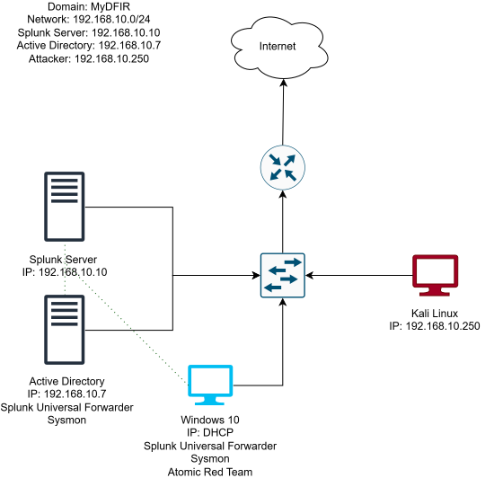

# 01: Planning and Network Diagram

## Goal
Map out the lab before building it so I understand how data flows between machines.

## Hardware Requirements
- 16 GB RAM and 250 GB free disk recommended
- Host used: AMD Ryzen 7 2700X, 16 GB RAM, 1 TB HDD, Windows 10 Pro

## Planned Environment
- 2 servers: Windows Server 2022 (Active Directory), Ubuntu Server (Splunk)
- 2 clients: Windows 10 (target), Kali Linux (attacker)
- Domain: `mydfir.local`
- Network: `192.168.10.0/24`

## Diagram
Built in draw.io. Dotted green lines show log forwarding from the domain controller and target machine to Splunk. The attacker (red) is not forwarding logs.

## What I Learned
The process of planning the network out before touching VirtualBox definitely made the later networking troubleshooting way easier, especially when my Target machine showed up with a default address of 10.0.2.15 instead of something within the intended range of 192.168.10.x. I was able to recognize it a NAT configuration issue: the VM's network adapter was still attached to VirtualBox's default NAT instead of the custom NAT network created for this lab. I go into more detail on solving this issue in the troubleshooting section, but having the IP scheme planned out ahead of time really made the misconfiguration apparent as soon as I saw the mismatching IP address. 

Mapping out the log-forwarding paths ahead of time also helped me understand why DNS is important within an AD environment: the Target machine needed to be able to find the domain controller by name, not just by IP address, so its DNS server had to point to the DC before the domain join would work. The interpretation of the attacker machine as a separate box that does not forward logs made sense once understood within a real-world scenario because you wouldn't want a potentially compromised machine's logs to mix with your trusted data, so it must be treated as outside the normal logging setup. 
