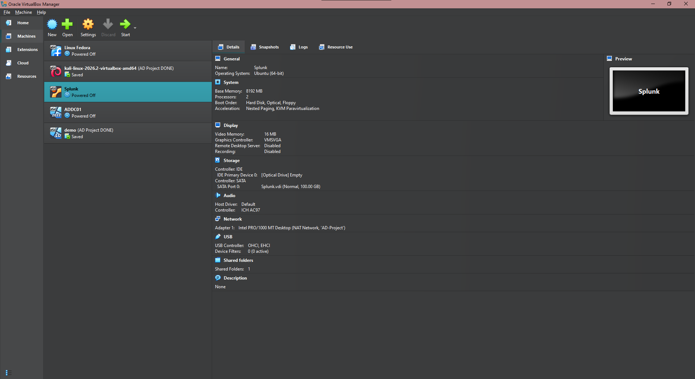
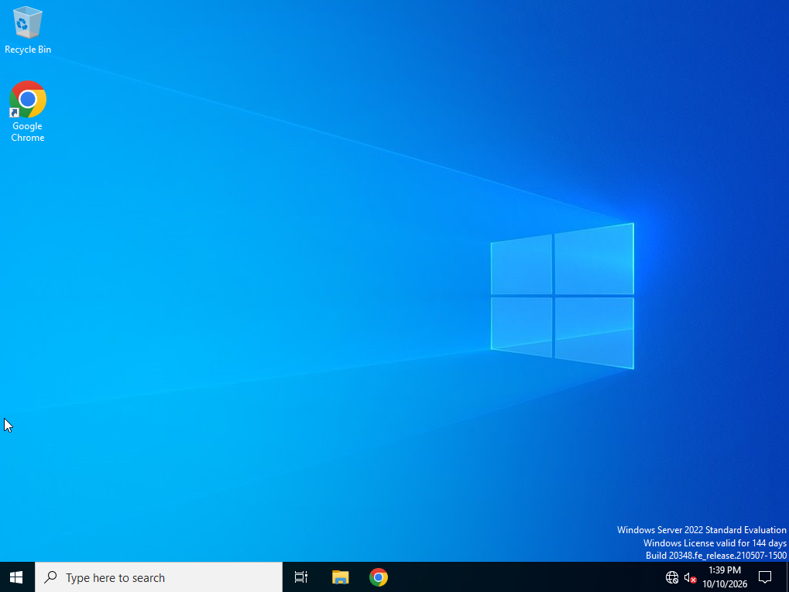
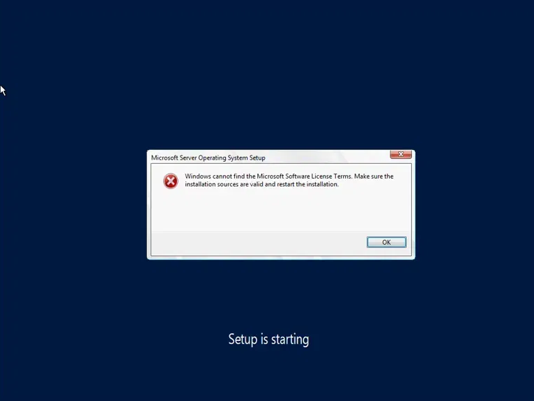

# 02: Virtual Machine Setup

## Goal
Install four VMs in VirtualBox: Windows 10, Kali Linux, Windows Server 2022, and Ubuntu Server (Splunk).

## Steps

### VirtualBox
- Downloaded VirtualBox and verified the installer's SHA-256 checksum with PowerShell:
  ```powershell
  Get-FileHash .\VirtualBox-installer.exe
  ```
- Installed the Microsoft Visual C++ dependency when prompted.

### Windows 10
- Created an ISO with [Microsoft's Media Creation Tool](https://support.microsoft.com/en-us/windows/deployment/install-upgrade/create-installation-media-for-windows)
- VM: 4 GB RAM, 1 CPU, 50 GB disk, Windows 10 Pro, custom install

### Kali Linux
- Imported the [pre-built VirtualBox image](https://www.kali.org/get-kali/#kali-virtual-machines) (extracted with 7-Zip)

### Windows Server 2022
- Downloaded the ISO from the [Microsoft Evaluation Center](https://www.microsoft.com/en-us/evalcenter/download-windows-server-2022)
- VM name `ADDC01`: 4 GB RAM, 1 CPU, 50 GB disk
- Selected **Standard Evaluation (Desktop Experience)** for the GUI
- **Ensure "Proceed with Unattended Installation" is unchecked**

### Ubuntu Server (Splunk)
- [Ubuntu Server 26.04](https://ubuntu.com/server): 8192 MB RAM, 2 CPUs, 100 GB disk (larger since it ingests and searches data)
- Ran `sudo apt-get update && sudo apt-get upgrade -y`

## Screenshots
VirtualBox with all four VMs (*Ignore "Linux Fedora" Virtual Machine*)


Windows Server desktop


## Issues and Fixes
- **Issue: VirtualBox's unattended installation feature breaking Windows Setup**

  I ran into this issue twice during VM setup, on two different machines, both times caused by the same thing: VirtualBox has an "unattended installation" feature that tries to install Windows automatically, by creating a small virtual floppy disk with a file that answers Setup's questions for you, then tries to click through the installer on its own. In both cases, this interfered with the setup rather than helping it.
  - **On ADDC01 (Windows Server):** It showed an explicit error dialog — "*Windows cannot find the Microsoft Software License Terms. Make sure the installation sources are valid and restart the installation.*" 
  - **On my Target machine ("demo", Windows 10):** After I deleted and rebuilt the VM, it caused a different issue — launching it never brought up the Windows Setup screens at all. I checked the VM's Storage settings, and it showed the same leftover unattended-install floppy disk still attached, confirming it was the same problem.
 
**Fix (same for both):** Shut down the VM, go to Settings > Storage, remove the "Unattended" floppy image, and ensure the checkmark under "Proceed with Unattended Installation" is removed when creating the VM. This allows the manual setup of Windows (explicitly selecting Windows 10 Pro edition instead of defaulting to Home), rather than VirtualBox automatically setting up Windows. 
  
## What I Learned
During the setup of four separate VMs, I learned that VirtualBox's unattended installation feature can work against you when you actually want control over the setup — such as explicitly choosing Windows 10 Pro instead of the default edition selected. Once I unchecked "Proceed with Unattended Installation" consistently, the setup became easier to continue with the walkthrough, rather than it automatically selecting the wrong Windows edition. I also learned to size each VM according to its role from the start rather than giving everything the same default specifications, as I gave the Splunk Server more RAM and CPU than the other machines because it is the only one to ingest and index data. 
