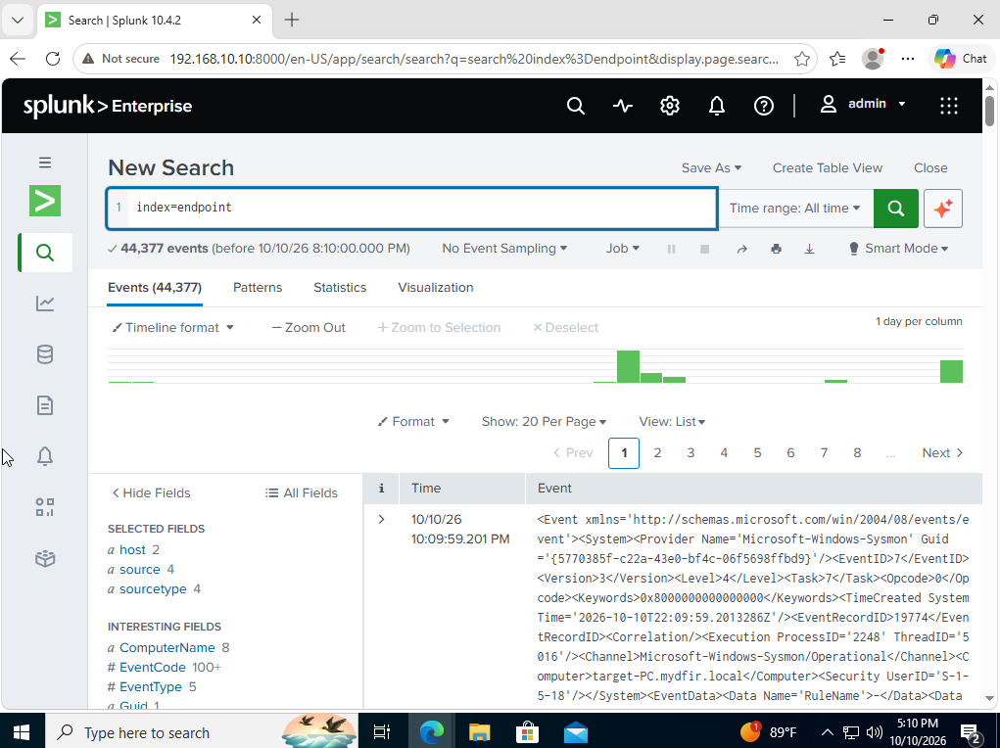
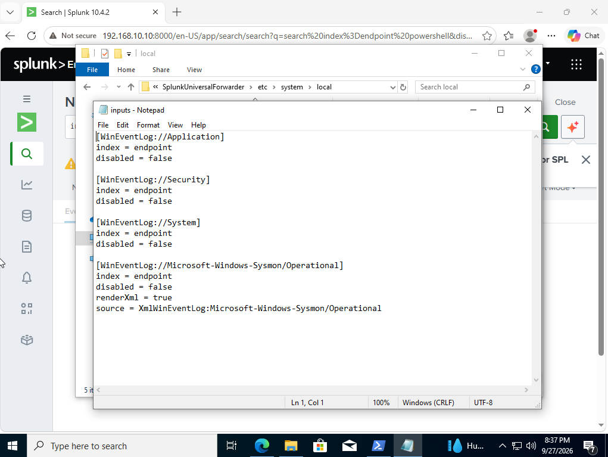
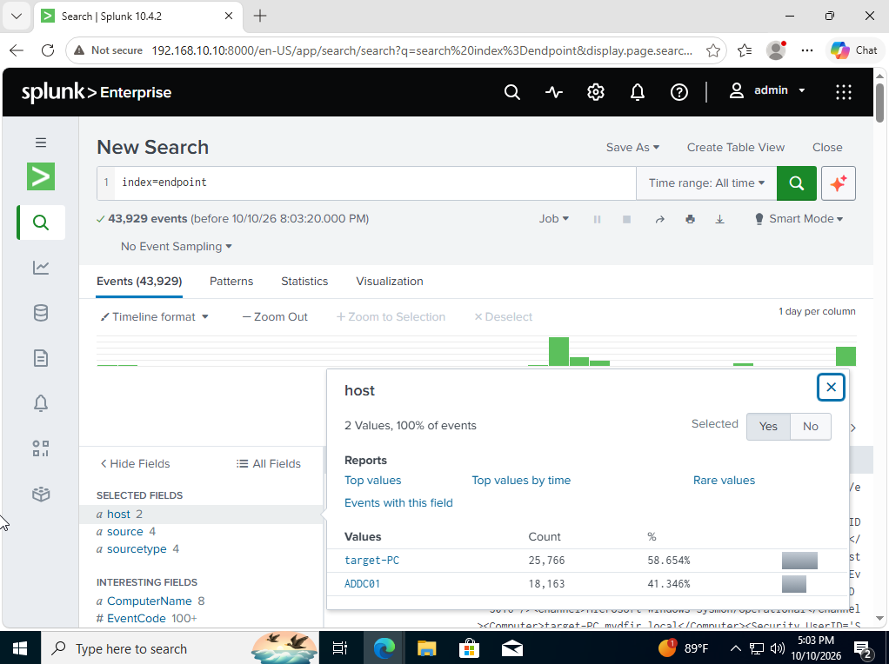

# 03: Splunk and Sysmon Configuration

## Goal
Collect endpoint telemetry with Sysmon and forward it to a Splunk server.

## 1. Network Setup
- Created a VirtualBox **NAT Network** named `ad-project` (`192.168.10.0/24`, DHCP enabled)
- Attached all four VMs to it

## 2. Splunk Server (Ubuntu)
- Set a static IP with Netplan (`/etc/netplan/`): address `192.168.10.10/24`, gateway `192.168.10.1`, DNS `8.8.8.8`, then `sudo netplan apply`
- Verified connectivity with `ping google.com`
- Installed VirtualBox Guest Additions, added my user to the `vboxsf` group, and mounted a shared folder to transfer the installer
- Installed Splunk Enterprise: `sudo dpkg -i <splunk>.deb`
- Started Splunk as the `splunk` user and enabled start on boot:
  ```bash
  sudo -u splunk bash
  /opt/splunk/bin/splunk start
  exit
  sudo /opt/splunk/bin/splunk enable boot-start -user splunk
  ```
- Web UI on port **8000**

## 3. Target PC (Windows 10)
- Renamed to `Target-PC`, set a static IP
- Installed **Splunk Universal Forwarder** (receiving indexer: Splunk server IP, port `9997`)
- Installed **Sysmon** with a community config (Olaf Hartong's `sysmonconfig.xml`):
  ```powershell
  .\Sysmon64.exe -i ..\sysmonconfig.xml
  ```
- Created `inputs.conf` in `...\SplunkUniversalForwarder\etc\system\local\` (not `default`) to forward Application, Security, System, and Sysmon logs to the `endpoint` index
- Set the forwarder service to log on as **Local System**, then restarted it

## 4. Splunk Configuration
- Created an index named `endpoint`
- Enabled receiving on port `9997` (Settings > Forwarding and receiving)
- Verified with the search `index=endpoint`

## 5. Domain Controller
- Renamed the server `ADDC01` and repeated the Sysmon and Universal Forwarder install and `inputs.conf` setup
- Confirmed Splunk showed two hosts

## Screenshots
Splunk index=endpoint results


inputs.conf file on local folder


Two hosts in Splunk


## Issues and Fixes
- **Issue: Target PC forwarding data (confirmed by `Test-NetConnection` and `index=_internal`) but `index=endpoint` show 0 events.**

I worked through multiple suspects of this issue — confirming the `endpoint` index existed, port 9997 was enabled for receiving, the SplunkForwarder service was running, and TCP connection to the Splunk server succeeded. Everything that checked seemed normal, which made it confusing. I found the problem after running `splunk cmd btool inputs list --debug` in the Target machine Command Prompt, this command revealed that my `inputs.conf` stanzas were mistyped as `[WinEvent://Application]` instead of the correct `[WinEventLog://Application]` (same for Security, System, and the Sysmon channel). Because I mistyped, leaving out "Log" meant Splunk never recognized them as valid Windows Event Log inputs, even though the file looked correctly formatted. 

**Fix:** I retyped the stanzas in the `inputs.conf` and restarted the forwarder in Services (services.msc).

- **Issue: ADDC01 showed 0 events under both `index=endpoint` and `index=_internal`**

When I attempting to confirm both hosts (ADDC01 and target-PC) were reporting to Splunk, I checked all the usual configuration points on ADDC01 — the SplunkForwarder service was running, `inputs.conf` and `outputs.conf` were both correctly formatted, Sysmon was running, the VM was on the correct NAT Network, and `Test-NetConnection` to port 9997 succeeded. Although all of these aspects passing, Splunk showed no events from ADDC01. I opened the `splunk.log` and it showed entries from weeks earlier because the service hadn't been restarted since the original setup. This made it look like nothing useful was in the log, when looking at old data instead of what was happening in real time. 

**Fix:** I opened Services (services.msc) and restarted the SplunkForwarder service, which produced a fresh log and revealed that the forwarder had been timing out off and on before it finally connected and remained connected. Once the connection was stable, `index=_internal host=ADDC01` started showing events, and searching `index=endpoint` with the time range set to "All time" confirmed both `target-PC` and `ADDC01` were sending data properly. 

## What I Learned
The issues that I stumbled upon during this section taught me the same lesson from two different angles: just because a config file looks right doesn't mean it actually is, so I need to check what the system itself is really doing instead of trusting what I see on the surface. With `inputs.conf`, a single missing word ("Log") was nearly impossible to catch on a normal look-through, and it took Splunk's own `btool` command, which shows exactly what the application parsed. With ADDC01, the mistake was not a config file, but it was trusting a log file without checking whether it was actually current. Now, I know to restart a service before reading its log when troubleshooting because an old log can look similar to a current one even though it's not actually showing what is occurring in real time.

Another major takeaway was that a successful connection test does not mean the whole pipeline works. `Test-NetConenction` only proves the network path and port are open, revealing nothing about whether the application using that port is sending the correct data, or any data at all. I learned to check each layer separately and in order: network connectivity, then the forwarder's internal telemetry (`index=_internal`), then the actual application data (`index=endpoint`) because a failure at any of the layers can produce the exact result of "no events," but each layer requires its own resolution. 
