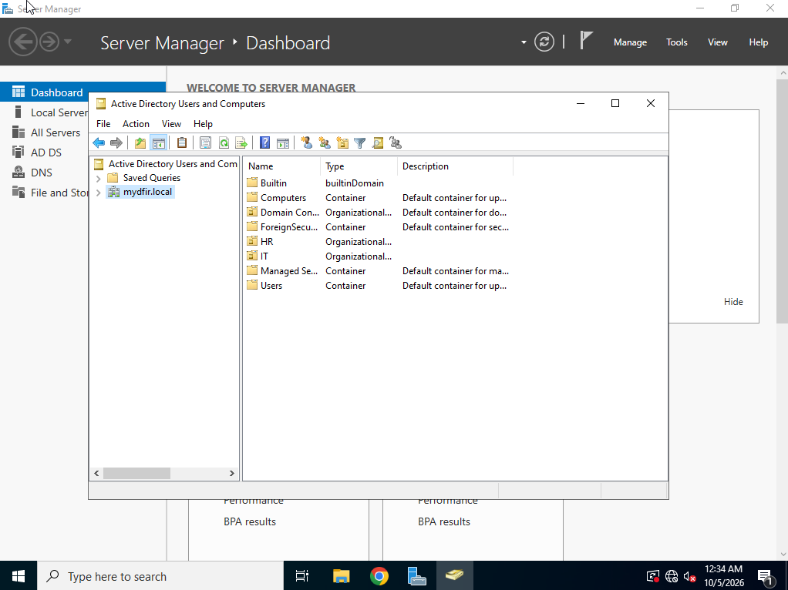
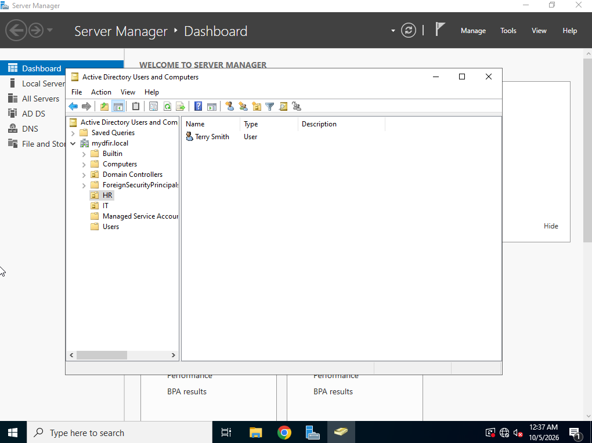
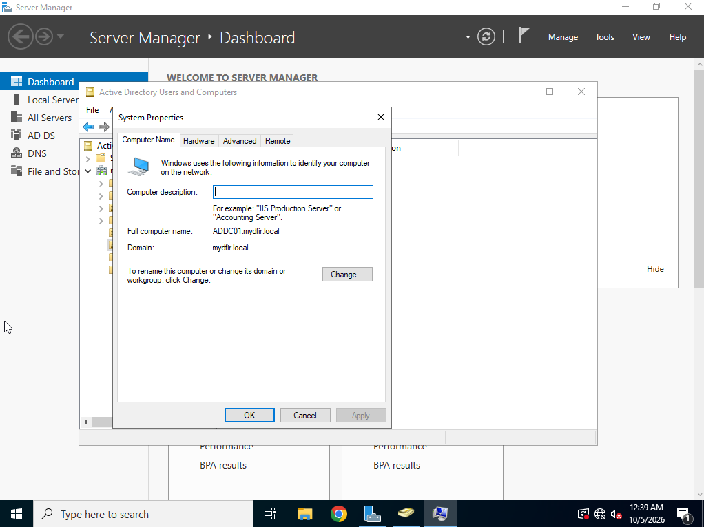
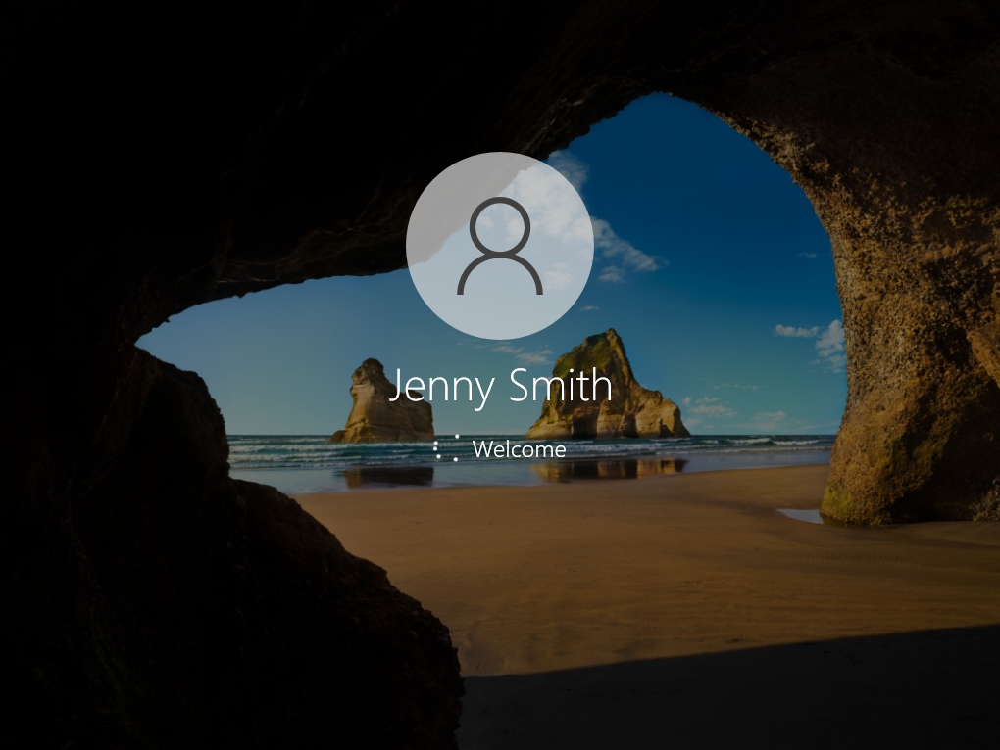
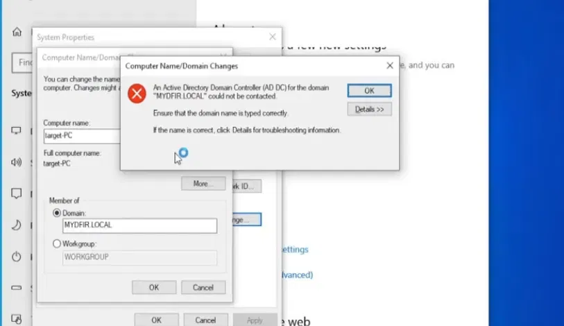

# 04: Active Directory Setup and Domain Join

## Goal
Install AD DS, promote the server to a domain controller, create users, and join the Windows 10 machine to the domain.

## Steps

### Domain Controller
- Set a static IP on ADDC01: `192.168.10.7`, mask `255.255.255.0`, gateway `192.168.10.1`
- Server Manager > Add Roles and Features > installed **Active Directory Domain Services**
- Promoted the server to a domain controller: **Add a new forest**, root domain `mydfir.local`
- Server restarted and I logged in as `MYDFIR\Administrator`

### Users and OUs
- Opened **Active Directory Users and Computers**
- Created Organizational Units: `IT` and `HR`
- Created users: Jenny Smith (`jsmith`) in IT and Terry Smith (`tsmith`) in HR

### Joining the Target PC
- Joining failed at first because the PC could not resolve `mydfir.local`. Fixed by pointing the PC's **DNS server to the domain controller (192.168.10.7)** instead of `8.8.8.8`
- Joined the domain via System Properties > Computer Name > Change
- Rebooted and logged in as `MYDFIR\jsmith`

## Screenshots
AD DS installed

Users and OUs

Domain join success

Logged in as domain user

## Issues and Fixes
- **Issue: Domain join failed with "An Active Directory Domain Controller for the domain 'MYDFIR.LOCAL' could not be contacted."**

The Target machine couldn't resolve `mydfir.local`, because its DNS server was still pointing at an external DNS (like Google's) instead of the domain controller. Active Directory relies on DNS to locate the domain controller by name, not just by IP address, so this has to be properly set before a domain join will succeed.

**Fix:** I changed the Target machine's preferred DNS server to the domain controller's IP address (`192.168.10.7`), then reattempted the domain join successfully. 

- **Issue: BSOD ("CRITICAL_PROCESS_DIED") immediately after completing the domain join, with no snapshot to return back to.**

After joining the domain and restarting as instructed, the Target VM crashed with a critical process failure and would no longer boot. I researched the stop code and attempted several recovery options — Startup Repair, System Restore, and manually rebuilding the boot files with `bootrec` and `bcdboot` from the Windows Recovery Environment but none of them resolved the problem. 

**Fix:** Because there was no snapshot to restore back to, I deleted and rebuilt the Target VM from the beginning (reinstalling Windows 10 Pro, renaming it, reconfiguring the network, and reinstalling Sysmon/Splunk Forwarder). Before I attempted to domain join, I took a snapshot first, which made the second attempt safer. On the side note, the rebuild did not take long at all because I already ran through the steps once before. 

## What I Learned
This section helped solidify my understanding about Active Directory, where AD is essentially a database of objects (users, computers, groups) that each carry their own attributes, which is why creating OUs and users felt like organizing records rather than just clicking through a wizard. The domain join failure reinforced how much AD depends on DNS specifically: a machine has to be able to resolve the domain name to find the DC, not just through its IP, which the reason behind changing the Target machine's DNS to the domain controller was the actual resolution. I also learned that `NTDS.dit` is where the domain's password hashes actually live, which made the domain controller feel like more valuable and highly-targeted. Finally, the BSOD that I ran into after this domain join instilled a lesson the hard way: a domain join can leave a machine in an unbootable state, and Windows' own recovery tools are not guaranteed to fix it. The process of taking a snapshot immediately before a risky step turned out to be far more reliable than attempting to repair the damage afterwards. 
